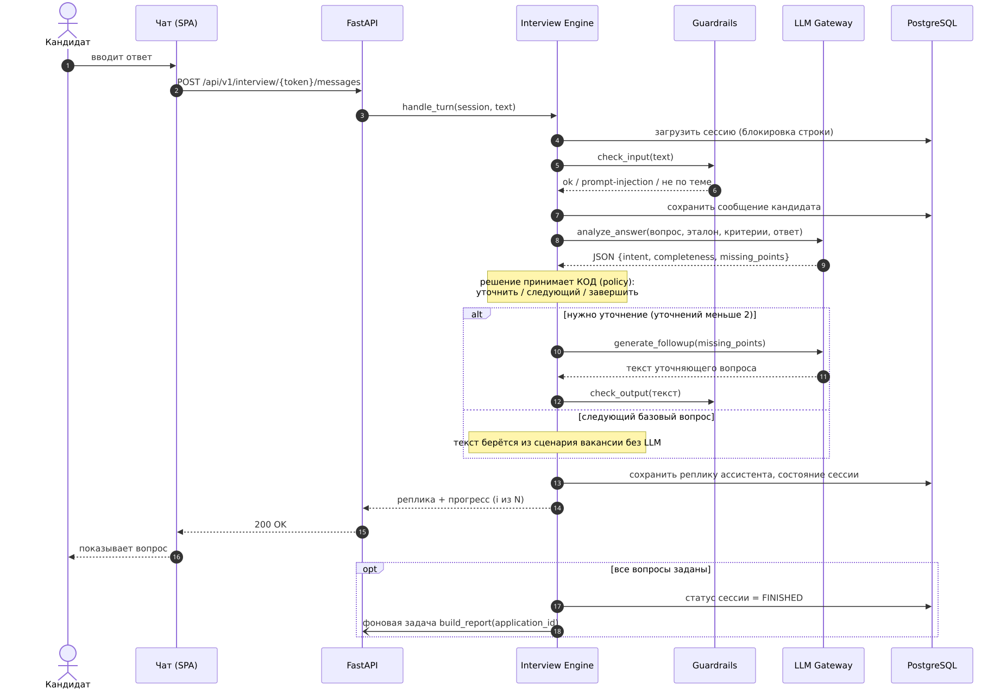

# Архитектура: AI-ассистент первичного интервью кандидатов

> TEAM-12 · версия 0.3 (12.11.2026: четыре сценария и демо-страница; 10.11: модель, проверка по пунктам) · черновик архитектуры
> Журнал решений: `docs/decisions.md`
> Основание: `01_PROJECT_CHARTER_Устав_и_паспорт_AI-системы.docx`, `TEAM-12. БТ и User Story.docx`, BPMN `diagram_5.svg`.
> Исходники схем лежат в `docs/diagrams/*.mmd` (Mermaid), там же готовые `*.svg` / `*.png` для отчётов.

---

## 1. Что делает система (в одном абзаце)

Рекрутер заводит вакансию и **сценарий**: до 10 базовых вопросов, к каждому — эталонный ответ и критерии.
Кандидату, прошедшему отбор по резюме, уходит **уникальная ссылка**. По ссылке кандидат даёт согласие на обработку ПДн
и в текстовом чате отвечает на вопросы. AI-ассистент проверяет **полноту** каждого ответа и, если нужно, задаёт
**до 2 уточняющих вопросов** на один базовый (всего не больше 20). После последнего вопроса система строит
**протокол** (JSON + PDF): ответы, сопоставленные с критериями, с дословными цитатами, **без баллов**.
Рекрутер получает уведомление, при необходимости правит протокол и сам принимает решение:
**пригласить / отклонить / отложить на 1–2 дня**. Система никогда не принимает решение и не отправляет отказ или приглашение сама.

Пилотных вакансий две (см. `docs/decisions.md`, D-002): **ML-инженер** (основная) и **аналитик ОМТО** по методике TS-AN-1.0 из гайда T06.
Сценарии вакансий — данные (JSON-файлы), а не код, поэтому новая вакансия не требует изменений в программе.

**Обновлено 12.11 (D-005):** сценариев четыре — аналитик ОМТО, ML-инженер Junior (основной), ML-инженер Middle (черновик) и проверка знаний по лекциям.
Тип сценария: `job_interview` или `knowledge_check`. В реальной работе сценарий выбирает рекрутер при создании вакансии;
для тестов и защиты есть **демо-страница `/demo`** (включается `DEMO_MODE=true`), где тестировщик сам выбирает сценарий.

**Обновлено 12.11 (D-006):** в проверке знаний вопросы хранятся банком (до 60), а в сессию попадает выборка (по умолчанию 10, с охватом всех тем) или все вопросы одной темы. План сессии сохраняется в `interview_session.question_plan`. Для собеседований — по-прежнему до 10 вопросов, все по порядку.

## 2. Ключевые требования, которые определяют архитектуру

| # | Требование (источник) | Как закрыто в архитектуре |
|---|---|---|
| R1 | Все обязательные вопросы должны быть заданы (Устав, guardrail) | Порядок вопросов ведёт **конечный автомат в коде**, а не LLM. Базовые вопросы берутся из сценария дословно |
| R2 | До 10 базовых и до 2 уточнений на вопрос (БТ) | Лимиты проверяет `Policy` в коде; LLM только советует «ответ неполный» |
| R3 | Система не оценивает кандидата и не ставит баллы (Устав, жёсткая граница) | В схеме отчёта нет полей для оценки; выход проверяет валидатор «оценочной лексики»; решение есть только в `Decision`, его создаёт рекрутер |
| R4 | Без выдуманных данных, смысл ответов сохраняется (Устав) | Каждое утверждение протокола опирается на **цитату с id сообщения**; валидатор сверяет цитату с транскриптом |
| R5 | Кандидат может прервать сессию и вернуться (БТ, риск №1) | Состояние сессии хранится в БД после каждого хода; та же ссылка продолжает диалог |
| R6 | 152-ФЗ: согласие, хранение в РФ (Устав) | Отдельный шаг согласия с версией текста и временем; БД и LLM в РФ / локально; при внешнем LLM ПДн маскируются |
| R7 | Бюджет 0 ₽, open-source / бесплатные API (Устав) | Open-source стек; LLM по умолчанию локально через Ollama |
| R8 | Рекрутер правит отчёт, история сохраняется (US-3) | Версии отчёта: v1 от AI не изменяется, правки создают v2…vN; журнал `audit_event` |
| R9 | «Отложить» с возвратом через 1–2 дня (US-2) | Статус `POSTPONED` + `postponed_until`; Scheduler возвращает в `UNDER_REVIEW` и напоминает |
| R10 | Интерфейс не более 5 переходов (Устав) | Кабинет: Вакансии → Кандидаты → Отчёт → Решение; чат кандидата — один экран |

## 3. Схема компонентов



**Стиль:** модульный монолит. Один Python-сервис (FastAPI) с чёткими модулями, одна БД PostgreSQL и SPA-фронтенд.
Для команды из 4 человек на один семестр это проще микросервисов, а границы модулей позволяют потом вынести, например, LLM-часть в отдельный воркер.

| Модуль | Ответственность | Использует LLM? |
|---|---|---|
| **REST API** | Маршруты, валидация (Pydantic), JWT для рекрутера, доступ кандидата по токену, rate-limit | нет |
| **Vacancy & Script** | CRUD вакансий и вопросов: текст, эталон, критерии, `required`, `max_followups` (≤ 2), лимит 10 | нет |
| **Invitation** | Генерация токена (32 байта, в БД хранится только хэш), срок жизни, деактивация, текст приглашения | нет |
| **Interview Engine** | Конечный автомат диалога (§4): ход кандидата → классификация → анализ полноты → решение policy → реплика | да |
| **Guardrails** | Вход: prompt-injection, флуд, длина, не по теме. Выход: тон, отсутствие оценок и решений, не раскрывать эталон | частично |
| **LLM Gateway** | Единый интерфейс `complete()/complete_json()`; провайдеры Ollama / GigaChat / YandexGPT; JSON-схемы, ретраи, таймауты, журнал `llm_call` | — |
| **Report Builder** | Протокол по каждому вопросу, проверка цитат и лексики, версия v1, запуск PDF | да |
| **PDF Renderer** | HTML-шаблон → PDF (WeasyPrint) | нет |
| **Application** | Статусная модель (§5), решения рекрутера, правки отчёта, аудит | нет |
| **Notifications** | Email (SMTP) и/или Telegram-бот: «отчёт готов», «напоминание по отложенному», приглашение кандидату | нет |
| **Scheduler** | APScheduler: возврат отложенных, истечение ссылок, напоминание кандидату о брошенной сессии | нет |

## 4. Как ведётся интервью (Interview Engine)



Главная идея: **это workflow, а не автономный агент.** LLM — «функция» внутри шага, а переходы между шагами и все лимиты задаёт код.
Так гарантированно выполняются R1–R3, поведение воспроизводимо и проще для проверки и защиты проекта.

Фиолетовые шаги на схеме вызывают LLM, зелёные решения принимает код:

1. **AWAIT_CONSENT** — показать текст согласия (152-ФЗ). Нет согласия → сессия закрывается, статус `CONSENT_DECLINED`.
2. **ASK_BASE** — отправить базовый вопрос *i* **дословно из сценария** (без LLM, чтобы формулировку нельзя было исказить).
3. **AWAIT_ANSWER** — ждать сообщение. Закрытие вкладки — это просто пауза: состояние уже в БД.
4. **Классификация намерения** (LLM, JSON): `answer` | `question_about_vacancy` | `off_topic` | `wants_to_stop`.
   - вопрос о вакансии → ответ **только по описанию вакансии**, если ответа там нет — «уточните у рекрутера», затем повтор текущего вопроса;
   - вне темы → вежливо вернуть к вопросу.
5. **ANALYZE** (LLM, JSON) — проверить ответ **по пунктам проверки** (`probes`) вопроса, а не сравнивать с эталоном целиком (D-004):
   ```json
   {"intent": "answer",
    "probes": [
      {"id": "p1", "status": "covered", "quote": "прогнозировали отток, смотрели recall"},
      {"id": "p2", "status": "missing", "quote": null},
      {"id": "p3", "status": "partial", "quote": "я в основном делал признаки"}
    ]}
   ```
   Затем **код** сверяет каждую цитату с текстом ответа (не нашлась → пункт `missing`) и считает полноту: все пункты `covered` → `complete`, иначе `partial` или `empty`.
   Это проверка **полноты информации**, а не качества кандидата. Результат сохраняется в `answer_analysis`.
6. **Policy (код):** `partial|empty` **и** `followups_used < max_followups (≤2)` → уточнение; иначе следующий вопрос.
7. **ASK_FOLLOWUP** (LLM) — короткий вежливый уточняющий вопрос по недостающим пунктам (одно уточнение может охватить два пункта), затем проверка выхода guardrails.
8. **FINALIZE** — благодарность, ссылка деактивируется, ставится фоновая задача построения отчёта.

### Последовательность одного хода



Ход обрабатывается в транзакции с блокировкой строки сессии (`SELECT … FOR UPDATE`), поэтому двойная отправка не сломает состояние.
Средняя стоимость хода — 2 вызова LLM (классификация и анализ можно объединить в один JSON-вызов) + 1 при уточнении.

## 5. Жизненный цикл кандидата (Application)



Статусы соответствуют BPMN-схеме команды. Переходы `APPROVED`, `REJECTED`, `POSTPONED` и `RESUME_REJECTED`
выполняются **только по действию рекрутера** (Human-in-the-loop). Разрешённые переходы перечислены в одной таблице в коде
(`application/status.py`), недопустимый переход возвращает ошибку 409.

Персональные данные (ФИО, контакты, резюме) принадлежат `Candidate`; диалог, протокол и решение принадлежат `Application`.
Один кандидат на двух вакансиях — это два независимых приложения (Устав, §7.1).

## 6. Протокол (отчёт) и защита от галлюцинаций



> **Изменение от 10.11 (D-004, предварительно):** протокол группируется **по критериям вакансии** (например, C01–C07), а не по вопросам: ответ на один вопрос может подтверждать несколько критериев.
> Основа протокола — уже проверенные результаты `answer_analysis` по пунктам, поэтому модели при построении отчёта остаётся меньше работы.
> Для критериев с `requires_practice: true` статус всегда `unknown`: самоотчёт в чате не заменяет практическую проверку (правило методики TS-AN-1.0).
> Пример ниже пока в старом формате «по вопросам», он будет обновлён после ответа преподавателя по шаблонам T01, T02, T04.

Отчёт строится **по каждому базовому вопросу отдельно** (короткий контекст — меньше галлюцинаций у небольших моделей). Пример `content`:

```json
{
  "schema_version": "1.0",
  "application_id": "…",
  "vacancy": "Junior+ Backend",
  "generated": {"at": "2026-11-08T12:00:00+05:00", "model": "qwen2.5:7b-instruct", "prompt_version": "report_v1"},
  "items": [
    {
      "question_id": "…",
      "question": "Расскажите о вашем опыте с PostgreSQL",
      "criteria": ["опыт ≥ 1 года", "оптимизация запросов"],
      "answer_summary": "Работал с PostgreSQL 2 года в проекте учёта заказов, писал индексы.",
      "criteria_coverage": [
        {"criterion": "опыт ≥ 1 года", "status": "mentioned", "evidence": [{"message_id": 41, "quote": "около двух лет"}]},
        {"criterion": "оптимизация запросов", "status": "partially_mentioned", "evidence": [{"message_id": 43, "quote": "добавлял индексы"}]}
      ],
      "followups_asked": 1,
      "needs_manual_check": false
    }
  ],
  "dialog_meta": {"started_at": "…", "finished_at": "…", "base_questions": 8, "followups": 5}
}
```

`status` ∈ `mentioned | partially_mentioned | not_mentioned` и означает **есть ли в ответе информация по критерию**, а не «хорош ли кандидат».

**Валидаторы (код, не LLM):**
- каждая `quote` должна быть подстрокой сообщения кандидата с указанным `message_id` (после нормализации пробелов и регистра);
- в тексте нет баллов, процентов, рейтингов и слов вида «рекомендую / не рекомендую / подходит / не подходит» (стоп-лист + регулярные выражения);
- при ошибке — до 2 повторов генерации, затем пункт помечается `needs_manual_check: true` и рядом показывается сырой ответ кандидата.

**Версии:** `report_version.version = 1` — AI-версия, она не изменяется. Правка рекрутера создаёт новую версию (`author = recruiter_id`),
событие пишется в `audit_event`. PDF генерируется из последней версии.

## 7. Модель данных



**Откуда берутся сценарии (D-003).** Сценарий вакансии пишется как JSON-файл в `scenarios/` (вопросы, критерии с весами, пункты проверки, эталонные ответы-примеры),
проверяется Pydantic-схемой и загружается в БД скриптом. Рекрутер затем правит вопросы в интерфейсе. Поля `recruiter_only` (шкалы 1–4, ключи кейсов) в модель интервью не передаются никогда.

Пример вопроса в сценарии:
```json
{
  "id": "ML-Q02", "order": 2,
  "text": "Расскажите о модели, которую вы довели от данных до продакшена. Что делали лично вы?",
  "criteria": ["ML-C02", "ML-C05"],
  "probes": [
    {"id": "p1", "text": "какая была задача и метрика успеха"},
    {"id": "p2", "text": "как готовили данные и валидировали модель"},
    {"id": "p3", "text": "что именно сделал кандидат лично"},
    {"id": "p4", "text": "результат в цифрах или эффект для бизнеса"}
  ],
  "reference_answer": "Пример сильного ответа: …",
  "max_followups": 2, "required": true
}
```
Критерии описаны на уровне вакансии: `id`, `name`, `weight`, `must_have`, `requires_practice`, `recruiter_only.rubric`.

- `question.criteria`, `question.probes` и `report_version.content` хранятся в JSONB: схема гибкая, но валидируется Pydantic-моделями.
- `answer_analysis` (новая таблица) — результат проверки каждого ответа: статусы пунктов, проверенные цитаты, решение policy. Из неё собирается протокол, а рекрутер видит, почему агент задал уточнение.
- Ответы кандидатов хранятся **только в БД** (персональные данные, транзакции). Для eval и отладки выгружаются в JSON.
- `message.kind` ∈ `consent | base_question | followup | answer | candidate_question | system`; `message.question_id` связывает реплику с базовым вопросом.
- `interview_session.token_hash` — SHA-256 токена; сам токен есть только в ссылке.
- `llm_call` — журнал вызовов без текста ПДн (purpose, модель, версия промпта, задержка, валиден ли JSON). Нужен для отладки и оценки качества.

## 8. LLM: выбор модели и промпты

**Выбрано (10.11.2026, D-001): GigaChat 3.1 Lightning локально через Ollama.** Подробности и замеры — в `docs/decisions.md`.

| Вариант | Плюсы | Минусы | Когда |
|---|---|---|---|
| **GigaChat 3.1 Lightning, Q4_K_M (Ollama)** — *по умолчанию* | MoE: 10B всего, 1,8B активных → быстро на CPU (~3 с на ход на ноутбуке без GPU); хороший русский; MIT; локально (152-ФЗ, 0 ₽) | Склонна выдумывать без JSON-схемы и проверок; в рассуждениях слабее 8B-моделей | Разработка, демо, пилот |
| T-lite-it-2.1 / Qwen3.5-9B | Сильнее в рассуждениях | На CPU ~5–7 ток/с — медленно для чата | Если появится сервер с GPU |
| GigaChat API | Российский провайдер, сильнее локальных | Лимиты, нужен договор для юрлица | Запасной вариант для демо |

**Правила работы с моделью на CPU (по замерам):**
- каждый вызов — короткий отдельный запрос, без истории всего диалога;
- неизменная часть промпта (системный промпт, вопрос, пункты проверки) в начале, ответ кандидата в конце — тогда начало берётся из кэша (0,15 с вместо ~35 с);
- официальный шаблон модели сам добавляет служебный блок ~1000 токенов; шаблон не меняем, блок кэшируется;
- `temperature: 0`, ответ по JSON-схеме, `num_predict` 600 (ограничитель; длина цитат ограничена схемой), `num_ctx` 4096;
- Ollama в системе (не в Docker) с `OLLAMA_KEEP_ALIVE=30m`, `OLLAMA_NUM_PARALLEL=1`; при старте бэкенда — прогревочный запрос;
- в памяти одна модель (16 ГБ RAM): она же строит протокол в фоне.

`LLM Gateway` прячет провайдера за интерфейсом, провайдер выбирается через `.env` (`LLM_PROVIDER=ollama`).
Для внешнего провайдера включается маскирование ПДн (ФИО, телефоны, email заменяются плейсхолдерами до отправки).

**Промпты** лежат файлами в `backend/app/interview/prompts/*.md` и `backend/app/reporting/prompts/*.md` с версией в имени (`analyze_answer.v1.md`).
Версия пишется в `llm_call` и в отчёт, поэтому любой протокол можно воспроизвести.

**RAG на MVP не нужен:** описание вакансии и сценарий (≤ 10 вопросов) помещаются в контекст целиком.
RAG имеет смысл добавить, если появится большая база знаний о компании для ответов на вопросы кандидатов.

## 9. Безопасность и 152-ФЗ

- Согласие: отдельный экран, сохраняются `consent_at` и `consent_text_version`; без согласия ни одно сообщение кандидата не сохраняется.
- Хостинг БД, файлов и LLM — в РФ (или локально). Логи приложения без ПДн.
- Ссылка: случайный токен, TTL (по умолчанию 7 дней, настраивается), деактивация после завершения, rate-limit на эндпоинты чата.
- Рекрутер: логин + JWT, у каждого рекрутера доступ только к своим вакансиям (или общий отдел — решить с заказчиком).
- Защита от prompt-injection: ответ кандидата всегда передаётся в промпт как **данные** в разделителях; системный промпт запрещает менять роль, раскрывать эталоны и давать оценки; выход проверяет guardrails.
- Срок хранения ПДн и удаление по запросу — задача Scheduler (настраиваемый retention).

## 10. API (основные эндпоинты)

**Кандидат** (доступ по токену из ссылки):

| Метод | Путь | Назначение |
|---|---|---|
| GET | `/api/v1/interview/{token}` | Состояние сессии: вакансия, прогресс, история сообщений |
| GET / POST | `/api/v1/demo/scenarios`, `/api/v1/demo/start` | Только при `DEMO_MODE`: список сценариев и старт демо-интервью |
| POST | `/api/v1/interview/{token}/consent` | `{accepted: bool}` |
| POST | `/api/v1/interview/{token}/messages` | Ответ кандидата → реплика ассистента |

**Рекрутер** (JWT):

| Метод | Путь | Назначение |
|---|---|---|
| POST | `/api/v1/auth/login` | Вход |
| CRUD | `/api/v1/vacancies`, `/api/v1/vacancies/{id}/questions` | Вакансии и сценарий |
| POST | `/api/v1/applications` | Добавить кандидата (отклик) |
| POST | `/api/v1/applications/{id}/invite` | Направить на AI-скрининг → ссылка |
| POST | `/api/v1/applications/{id}/reject-resume` | Отказ по резюме |
| GET | `/api/v1/applications?status=…` | Список, фильтры, папка «Отложенные» |
| GET | `/api/v1/applications/{id}/report` | Последняя версия отчёта + транскрипт |
| PUT | `/api/v1/applications/{id}/report` | Правка → новая версия |
| GET | `/api/v1/applications/{id}/report.pdf` | PDF |
| POST | `/api/v1/applications/{id}/decision` | `{action: approve\|reject\|postpone, comment, postpone_days}` |

## 11. Оценка качества (eval)

Метрики берутся из guardrails Устава и проверяются автоматически на синтетических диалогах (`eval/datasets/`):

| Метрика | Как считаем | Цель |
|---|---|---|
| Покрытие обязательных вопросов | доля сессий, где заданы все `required` | 100 % |
| Соблюдение лимита уточнений | уточнений на вопрос ≤ 2 | 100 % |
| Достоверность протокола | доля цитат, прошедших сверку с транскриптом | ≥ 98 % |
| Отсутствие оценок | срабатывания стоп-листа в финальных отчётах | 0 |
| Уместность уточнений | LLM-судья + ручная разметка 30 диалогов | ≥ 80 % |
| Тон | LLM-судья «вежливо / нейтрально» | ≥ 95 % |
| **KPI бизнеса** | время рекрутера от открытия отчёта до решения (событие в `audit_event`) | 60 → ~15 мин |

## 12. Технологический стек

| Слой | Выбор | Почему |
|---|---|---|
| Backend | Python 3.11, FastAPI, Pydantic v2, SQLAlchemy 2 + Alembic | Стандарт для LLM-проектов, async, автодокументация OpenAPI |
| БД | PostgreSQL 16 | JSONB, блокировки строк, бесплатно |
| Фоновые задачи | FastAPI BackgroundTasks + APScheduler | Без Redis и брокера; при росте → arq/Celery |
| LLM | Ollama + GigaChat 3.1 Lightning (Q4_K_M), `httpx` | 0 ₽, локально, быстро на CPU |
| PDF | WeasyPrint + Jinja2 | HTML-шаблон, кириллица без проблем |
| Frontend | React + TypeScript + Vite, TanStack Query | Две зоны в одном SPA |
| Уведомления | SMTP (aiosmtplib), опционально Telegram Bot API | Бесплатно |
| Инфраструктура | Docker Compose: `db`, `backend`, `frontend` (nginx), `ollama` | Запуск одной командой |
| Качество | pytest, ruff, mypy, GitHub Actions | |

## 13. Распределение работ (предложение)

| Участник | Зона |
|---|---|
| Кондратов Д. С. | Interview Engine, LLM Gateway, промпты, guardrails |
| Бойченко П. С. | Backend: модели, API, статусы, авторизация, Docker |
| Щербакова В. Н. | Frontend: чат кандидата и кабинет рекрутера |
| Мальцева А. Е. | Report Builder + PDF, eval-датасеты и метрики, уведомления |

## 14. План MVP по итерациям

1. **Скелет:** Docker Compose, БД и миграции, CRUD вакансий и вопросов, генерация ссылки.
2. **Диалог:** согласие → базовые вопросы по порядку без LLM (автомат уже работает) → сохранение и возобновление сессии.
3. **AI-шаги:** анализ полноты + уточнения, классификация намерений, guardrails.
4. **Отчёт:** JSON-протокол с цитатами, валидаторы, PDF, уведомление.
5. **Кабинет:** просмотр и правка отчёта, решения, «Отложенные» + напоминания.
6. **Eval и полировка:** синтетические диалоги, метрики, замер KPI на пилоте.

## 15. Открытые вопросы к заказчику

- **Противоречие в формулировках:** в Уставе «система не оценивает кандидата», в БТ — «предварительная оценка по критериям». В архитектуре принято: система показывает **наличие информации по критерию** (`mentioned / partially / not_mentioned`) с цитатами, без баллов и вердиктов. Нужно подтвердить.
- ~~Пилотная вакансия и итоговый список вопросов~~ → предварительно две вакансии: ML-инженер и аналитик ОМТО из гайда T06 (D-002). Нужно подтвердить у преподавателя.
- Шаблоны итоговых документов из методики TS-AN-1.0: T01, T02, T04, Candidate Record, SF01, EV-ID. Протокол должен ложиться на них.
- Нужен ли предварительный балл 1–4 (методика) при запрете баллов (устав); можно ли пропускать вопрос, если ответ уже прозвучал. Полный список — в `docs/decisions.md`.
- Откуда приходят отклики: ручное добавление, импорт или интеграция с hh.ru (в MVP — ручное добавление).
- Канал приглашения кандидата: email, мессенджер или ссылку копирует рекрутер.
- Срок жизни ссылки и срок хранения ПДн.
- Сервер: есть ли у заказчика машина с GPU в РФ. Для разработки и демо решено: ноутбук без GPU + GigaChat 3.1 Lightning (D-001).
