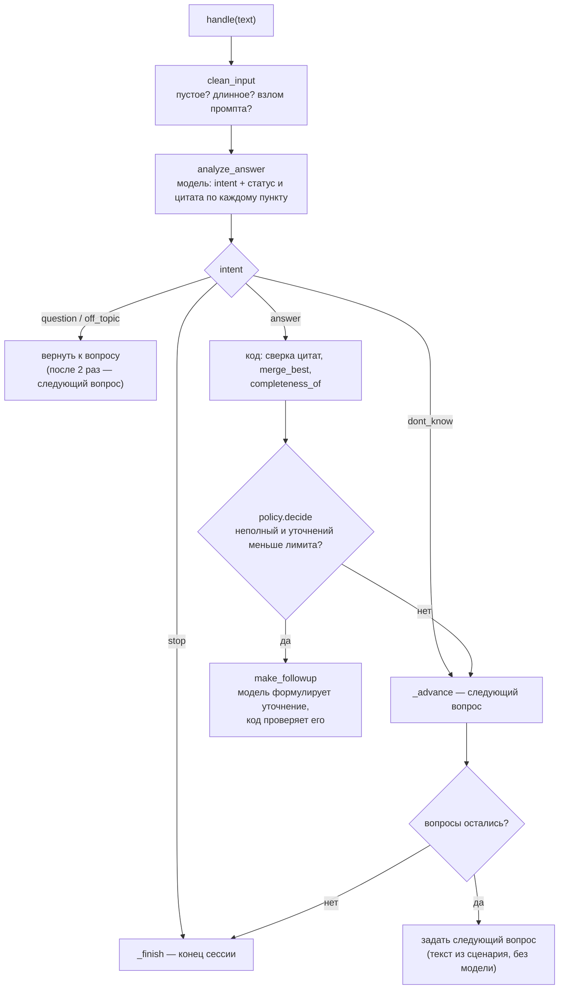

# Руководство разработчика

> Как устроен код, как он работает и как его менять. Для участников команды TEAM-12.
> Что и почему решили — в [`decisions.md`](decisions.md); как система устроена целиком — в [`ARCHITECTURE.md`](ARCHITECTURE.md);
> карта всех файлов, включая будущие, — в [`STRUCTURE.md`](STRUCTURE.md); план работ — в [`NEXT_STEPS.md`](NEXT_STEPS.md).

## Содержание

1. [С чего начать](#1-с-чего-начать)
2. [Что уже работает, а что заготовка](#2-что-уже-работает-а-что-заготовка)
3. [Как проходит один ход интервью](#3-как-проходит-один-ход-интервью)
4. [Модули подробно](#4-модули-подробно)
5. [Рецепты: как сделать типовые вещи](#5-рецепты-как-сделать-типовые-вещи)
6. [Тесты и проверки](#6-тесты-и-проверки)
7. [Работа с git](#7-работа-с-git)
8. [Частые проблемы](#8-частые-проблемы)

---

## 1. С чего начать

1. Поставить окружение и запустить прототип — [README](../README.md#быстрый-старт).
2. Пройти одну сессию: `python -m app.cli student_course --size 3 --verbose`.
3. Прочитать в таком порядке:
   - [`scenarios/README.md`](../scenarios/README.md) и любой сценарий, например `scenarios/ml_junior.json` — **что** спрашивает агент;
   - `backend/app/interview/runner.py` — **как** идёт диалог (главный файл);
   - `backend/app/interview/analyzer.py` и промпт `backend/app/interview/prompts/analyze_answer.v2.md` — как проверяется ответ;
   - `backend/app/reporting/protocol.py` — что получается на выходе.
4. Посмотреть тесты `backend/tests/unit/test_runner.py` — они читаются как спецификация поведения.

**Три правила, на которых держится проект** (подробно — D-004 в `decisions.md`):
- **Решения принимает код, а не модель.** Модель только отвечает на узкие вопросы («есть ли в ответе этот пункт», «сформулируй уточнение»). Порядок вопросов, лимит уточнений, переходы — в коде.
- **Модели не верим на слово.** Каждую цитату код сверяет с текстом ответа; выдуманная цитата отклоняется.
- **Никаких баллов и вердиктов.** Протокол показывает, есть ли информация по пункту, а решение принимает человек.

---

## 2. Что уже работает, а что заготовка

✅ — работает и покрыто тестами · 🧩 — файл есть, но внутри только описание (docstring) или каркас · 🆕 — файла ещё нет, появится по плану.

| Часть | Статус | Файлы |
|---|---|---|
| Сценарии вакансий и их проверка | ✅ | `scenarios/*.json`, `backend/app/schemas/scenario.py`, `backend/app/scenarios.py`, `scripts/validate_scenarios.py` |
| Выбор вопросов на сессию | ✅ | `backend/app/interview/question_plan.py` |
| Диалог: анализ, уточнения, переходы | ✅ | `backend/app/interview/runner.py`, `analyzer.py`, `followup.py`, `policy.py`, `guardrails.py` |
| Работа с моделью | ✅ | `backend/app/llm/base.py`, `ollama.py`, `fake.py`, `prompts.py` |
| Протокол и проверки кодом | ✅ | `backend/app/reporting/protocol.py`, `validators.py` |
| Консольный прототип | ✅ | `backend/app/cli/__main__.py` |
| API демо и чата (сессии в памяти) | ✅ | `backend/app/api/v1/demo.py`, `interview.py`, `backend/app/interview/store.py`, `backend/app/main.py` |
| Веб-интерфейс: /demo, чат, отладка, протокол | ✅ | `frontend/src/demo/`, `candidate/ChatPage.tsx`, `components/` |
| Переходы статусов кандидата | ✅ (только таблица и проверка) | `backend/app/services/application_service.py` |
| База данных, модели, миграции | 🧩 | `backend/app/db/`, `backend/app/models/`, `backend/migrations/` |
| Остальное HTTP API (рекрутер, вакансии, отчёты, вход) | 🧩 | `backend/app/api/v1/auth.py`, `vacancies.py`, `applications.py`, `reports.py` |
| Interview Engine с сохранением в БД | 🧩 | `backend/app/interview/engine.py` (будет обёрткой над `runner.py`) |
| Ответы на вопросы кандидата о вакансии | 🧩 | `backend/app/interview/candidate_qa.py` |
| PDF, отчёт для рекрутера, версии | 🧩 | `backend/app/reporting/builder.py`, `pdf.py` |
| GigaChat API, маскирование ПДн | 🧩 | `backend/app/llm/gigachat.py`, `pii.py` |
| Уведомления, планировщик | 🧩 | `backend/app/notifications/`, `backend/app/jobs/` |
| Кабинет рекрутера, экран согласия по ссылке | 🧩 | `frontend/src/recruiter/`, `candidate/ConsentScreen.tsx` |
| Оценка качества (eval) | 🧩 | `eval/` |

Промпты `*.v1.md` в `backend/app/interview/prompts/` — старые черновики, в коде не используются. Рабочие — `analyze_answer.v2.md` и `followup.v2.md`.

---

## 3. Как проходит один ход интервью

Человек написал ответ → `InterviewRunner.handle(text)`:



На каждый ход — **1 вызов модели** (анализ) и ещё **1**, если нужно уточнение. На ноутбуке без GPU это ~3 с на вызов после прогрева (D-001).

Как это выглядит в коде (упрощённо):

```python
from app.interview.runner import InterviewRunner
from app.llm.ollama import OllamaProvider
from app.reporting.protocol import build_protocol
from app.scenarios import load_scenario

runner = InterviewRunner(load_scenario("ml_junior"), OllamaProvider())
print(runner.start().text)          # приветствие + первый вопрос
while not runner.finished:
    reply = runner.handle(input())  # ответ человека → реплика ассистента
    print(reply.text)
protocol = build_protocol(runner)   # dict, сериализуется в JSON
```

Консольная программа (`app/cli`) — это ровно этот цикл плюс печать. Будущий API будет делать то же самое, но между ходами сохранять состояние в БД.

---

## 4. Модули подробно

### 4.1. Сценарий — `backend/app/schemas/scenario.py`

Pydantic-схема JSON-файла из `scenarios/`. Формат описан в [`scenarios/README.md`](../scenarios/README.md).

| Класс | Что описывает |
|---|---|
| `Scenario` | Вакансия или курс: `kind` (`job_interview` / `knowledge_check`), `criteria`, `questions`, `session`, `agent_rules` |
| `Criterion` | Критерий или тема: вес, `must_have`, `requires_practice` |
| `Question` | Вопрос: текст, критерии, пункты проверки `probes`, пример ответа, лимит уточнений |
| `Probe` | Пункт проверки: что должно прозвучать в ответе |
| `SessionPlan` | Для проверки знаний: сколько вопросов в сессии и как выбирать |

Проверки в схеме (нарушение → ошибка при загрузке): не больше 10 вопросов в собеседовании и 60 в банке, не больше 2 уточнений, id уникальны, критерии существуют, сумма весов 100 % для готовых сценариев.

**Важно:** `Scenario.llm_view()` возвращает сценарий без `recruiter_only` (шкалы, заметки). В модель передаётся только это; тест `test_llm_view_has_no_recruiter_only` следит за этим.

### 4.2. Выбор вопросов — `backend/app/interview/question_plan.py`

`plan_questions(scenario, rng=None, topic=None) -> list[Question]`
- собеседование — все вопросы по порядку;
- проверка знаний — `session.size` вопросов: сначала по одному из каждой темы, остальные случайно, затем сортировка по порядку в сценарии;
- `topic="T03"` — все вопросы одной темы (тренировка);
- `rng=random.Random(seed)` делает выбор воспроизводимым (для тестов и бенчмарка).

### 4.3. Работа с моделью — `backend/app/llm/`

| Файл | Главное |
|---|---|
| `base.py` | `LLMProvider` — интерфейс с одним методом `chat(messages, json_schema=None)`. `complete_json(provider, messages, Schema, purpose=..., prompt_version=..., log=...)` — вызов с ответом строго по Pydantic-схеме: вырезает JSON из ответа, проверяет, при ошибке повторяет до 2 раз с текстом ошибки, пишет `LLMCall` в журнал. Если так и не получилось — `LLMError`. |
| `ollama.py` | `OllamaProvider` — HTTP к Ollama на стандартной библиотеке. JSON-схема передаётся в `format`, поэтому модель физически не может вернуть другую структуру. Параметры по умолчанию из замеров: `temperature=0`, `num_ctx=4096`, `keep_alive=30m`. `warmup()` — прогрев. Модель и адрес берутся из аргументов или из `LLM_MODEL` / `OLLAMA_URL`. |
| `fake.py` | `FakeLLM` для тестов: отдаёт заданные ответы по очереди (строка, dict или функция от сообщений). Запросы сохраняет в `.requests`. |
| `prompts.py` | `load_prompt(name, version)` читает `name.version.md`, `render(template, key=value)` подставляет `{{key}}`. |

**Формат файла промпта:**
```
<<<system>>>
Неизменная инструкция...
<<<user>>>
Вопрос: {{question}}
...
<answer>
{{answer}}
</answer>
```

**Правила для промптов:**
- **Не правьте версию, которая уже используется.** Скопируйте в `*.v3.md`, поменяйте `PROMPT_VERSION` в модуле. Версия пишется в журнал вызовов, по ней можно воспроизвести любой результат и сравнить версии в eval.
- **Неизменное — в начале, ответ человека — в конце.** Ollama кэширует начало промпта; так повторные вызовы читают промпт за 0,15 с вместо ~30 с (D-001).
- **Ответ человека — всегда внутри `<answer>…</answer>`**, а `clean_input` заменяет в нём угловые скобки: так ответ не может «закрыть» тег и выдать себя за инструкцию.

### 4.4. Анализ ответа — `backend/app/interview/analyzer.py`

`analyze_answer(provider, question, answers, log=...) -> Analysis`

1. Отправляет в модель вопрос, пункты проверки, пример ответа и **все** ответы человека на этот вопрос (основной + после уточнений).
2. Модель возвращает `intent` и по каждому пункту `covered` / `partial` / `missing` с цитатой.
3. **Код** проверяет каждую цитату (`quote_is_grounded`): нет в ответе → пункт `missing`, `quote_rejected=True`.
4. `completeness_of`: все `covered` → `complete`; хоть что-то есть → `partial`; иначе `empty`.
5. Модель не ответила (`LLMError`) → ответ считается полным, `llm_failed=True`: интервью идёт дальше, вопрос помечается «проверить вручную».

`merge_best(old, new)` — пункт, раскрытый в одном из ответов на вопрос, не теряется, если следующий анализ его не увидел.

### 4.5. Уточнение — `backend/app/interview/followup.py`

`make_followup(provider, question, answers, missing) -> str` — модель формулирует один вопрос по недостающим пунктам. Вместо её текста подставляется нейтральная фраза `FALLBACK`, если модель не ответила, вопрос длиннее 40 слов или без «?», есть оценочные слова или 4 слова подряд из эталонного ответа (`leaks_reference`) — то есть уточнение подсказывает ответ.

### 4.6. Политика и защита

- `policy.py` — `decide(PolicyInput) -> NextStep`: уточнение, следующий вопрос или конец. Лимит уточнений — здесь, а не в промпте.
- `guardrails.py` — `clean_input(text) -> (text, flags)`: флаги `empty`, `too_long` (обрезка до 2000 символов), `injection` (попытка дать модели указания). `output_is_safe(text, reference)` — нет оценок и пересказа эталона.
- `reporting/validators.py` — `normalize`, `quote_is_grounded` (точное вхождение после нормализации или совпадение ≥ 85 %), `has_forbidden_language`, `leaks_reference`.

### 4.7. Диалог — `backend/app/interview/runner.py`

`InterviewRunner(scenario, provider, plan=None, rng=None, topic=None)`

| Метод / поле | Что делает |
|---|---|
| `start() -> Reply` | Приветствие и первый вопрос |
| `handle(text) -> Reply` | Один ход (схема в §3) |
| `stop() -> Reply` | Прервать сессию (Ctrl+C) |
| `states: list[QuestionState]` | По каждому вопросу: ответы, число уточнений, пункты, полнота, `ended_by`, флаги |
| `transcript: list[Turn]` | Все реплики по порядку |
| `llm_log: list[LLMCall]` | Журнал вызовов модели |
| `finished`, `stopped` | Сессия закончена; закончена досрочно |

`Reply`: `text`, `finished`, `question_number`, `total_questions`.

`QuestionState.ended_by` — почему ушли с вопроса: `complete`, `followup_limit`, `dont_know`, `off_topic`, `stopped`, `llm_failed`.

### 4.8. Протокол — `backend/app/reporting/protocol.py`

`build_protocol(runner) -> dict`, без вызовов модели. Структура:

```json
{
  "scenario": {"id": "ml_junior", "title": "...", "kind": "job_interview", "level": "junior"},
  "started_at": "...", "finished_at": "...", "stopped_early": false,
  "criteria": [
    {"id": "J01", "name": "Основы ML", "status": "partial", "label": "частично", "questions": ["Q02", "Q03"]},
    {"id": "J04", "name": "Python и качество кода", "status": "unknown", "label": "нужна практическая проверка"}
  ],
  "questions": [
    {"id": "Q02", "answers": ["..."], "followups": 1, "ended_by": "followup_limit", "completeness": "partial",
     "needs_manual_check": false, "flags": [],
     "probes": [{"id": "p1", "text": "...", "status": "covered", "quote": "отложил 20% данных"}]}
  ],
  "transcript": [{"role": "assistant", "kind": "base_question", "text": "...", "question_id": "Q02", "at": "..."}],
  "llm": {"model": "gigachat-lightning", "calls": 12, "invalid_json": 0, "avg_latency_ms": 3100, "max_latency_ms": 5400, "log": []}
}
```

Статус критерия: все пункты `covered` → `covered`; что-то раскрыто → `partial`; ничего → `missing`; критерий с `requires_practice` → всегда `unknown`.

### 4.9. API демо и чата — `backend/app/api/v1/`, `backend/app/interview/store.py`

Бэкенд — тот же `InterviewRunner`, обёрнутый в HTTP. Сессии лежат в `SessionStore` в памяти процесса (D-008): токен → runner. На этапе 2 хранилище заменится БД, контракт API останется.

| Метод | Путь | Что делает |
|---|---|---|
| GET | `/api/v1/demo/health` | Доступна ли Ollama и скачана ли модель (`OllamaProvider.ping`) |
| GET | `/api/v1/demo/scenarios` | Карточки сценариев: тип, уровень, сколько вопросов в сессии, темы |
| POST | `/api/v1/demo/start` | `{scenario_id, topic?, size?, seed?}` → новая сессия (201) |
| GET | `/api/v1/interview/{token}` | Состояние: сообщения, прогресс, `debug` по последнему ответу |
| POST | `/api/v1/interview/{token}/messages` | `{text}` → ход; 409 — предыдущий ещё обрабатывается или сессия закончена; **503 — модель недоступна, ответ не засчитан** |
| POST | `/api/v1/interview/{token}/stop` | Досрочно завершить |
| GET | `/api/v1/interview/{token}/protocol` | Протокол (`build_protocol`); для проверки знаний + `references` — эталоны |

- `/demo/*` работают только при `DEMO_MODE=true`, иначе 404.
- Эндпоинты синхронные (`def`): вызов модели блокирующий, FastAPI выполняет их в пуле потоков. В сессии одновременно обрабатывается один ход (блокировка в `SessionEntry`).
- Модель создаётся один раз при старте (`main.py`, `app.state.provider`) и при `DEMO_MODE` прогревается в фоне.
- Если Ollama недоступна, провайдер бросает `LLMUnavailable`; анализ его не глотает, а `runner.handle` не меняет состояние до успешного анализа — тот же ответ можно отправить ещё раз.
- Swagger со всеми эндпоинтами: http://localhost:8000/docs.

### 4.10. Веб-интерфейс — `frontend/`

React 18 + TypeScript + Vite, без UI-библиотек и менеджеров состояния.

| Файл | Что делает |
|---|---|
| `vite.config.ts` | Порт 5173, прокси `/api` → `localhost:8000` |
| `src/main.tsx` | Маршруты: `/demo`, `/i/:token` |
| `src/api/client.ts` | Все запросы к API, `ApiError` с понятным текстом |
| `src/types.ts` | Типы ответов API (повторяют `schemas/interview.py` и протокол) |
| `src/labels.ts` | Русские подписи статусов, склонение «вопрос/вопроса/вопросов» |
| `src/demo/DemoPage.tsx` | Статус модели, карточки сценариев, выбор темы, согласие для собеседований, старт |
| `src/candidate/ChatPage.tsx` | Чат: сообщения, ввод (Enter / Shift+Enter), индикатор ожидания с секундами, «Завершить», «Отладка» (запоминается в браузере), протокол в конце |
| `src/components/DebugPanel.tsx` | Разбор последнего ответа: пункты ✓ ~ ✗ с цитатами, время вызовов модели |
| `src/components/ProtocolView.tsx` | Протокол: критерии/темы, ответы по вопросам, эталоны, «Скачать JSON» |
| `src/styles.css` | Все стили; светлая и тёмная тема по настройке системы |

Если API меняется — обновите `src/types.ts`, иначе `npm run build` упадёт на проверке типов (это и хорошо).

### 4.11. Консольный прототип — `backend/app/cli/__main__.py`

```
python -m app.cli [сценарий] [--list] [--topic T03] [--size 5] [--seed 42]
                  [--model ...] [--url ...] [--verbose] [--no-reference]
```
`--verbose` — время каждого вызова модели после хода; `--seed` — тот же набор вопросов при повторе; `--no-reference` — не показывать эталоны в конце. Протокол сохраняется в `storage/cli_sessions/ДАТА_ВРЕМЯ_сценарий.json`.

---

## 5. Рецепты: как сделать типовые вещи

### Добавить или изменить сценарий
1. Скопировать похожий файл в `scenarios/`, поменять `id` (латиница и `_`) и тексты.
2. `python scripts/validate_scenarios.py` — покажет ошибки схемы.
3. Проверить вживую: `cd backend && python -m app.cli <id> --verbose`.
4. Пока сценарий не согласован — `"status": "draft"`.

Пункты проверки (`probes`) — главное в сценарии: 3–4 на вопрос, каждый — одна конкретная вещь, которую можно найти в тексте. «Понимает ML» — плохой пункт; «называет схему разбиения: train/validation/test или кросс-валидация» — хороший.

### Изменить промпт
1. Скопировать `analyze_answer.v2.md` в `analyze_answer.v3.md`, внести правки.
2. В `analyzer.py` поменять `PROMPT_VERSION = "v3"`.
3. Прогнать тесты и 2–3 сессии в консоли, сравнить протоколы со старой версией.

### Подключить другую модель или провайдера
- Другая модель в Ollama: `python -m app.cli ml_junior --model qwen3.5:4b` или `export LLM_MODEL=...`.
- Другой провайдер: класс с атрибутом `model` и методом `chat(messages, *, json_schema=None) -> ChatResult` (см. `ollama.py`); при ошибке — `LLMError`. Больше ничего менять не нужно: остальной код работает через интерфейс `LLMProvider`.

### Написать тест без модели
```python
from app.interview.runner import InterviewRunner
from app.llm.fake import FakeLLM
from app.scenarios import load_scenario

def test_dont_know_skips_question():
    llm = FakeLLM([{"intent": "dont_know", "probes": []}])
    runner = InterviewRunner(load_scenario("student_course"), llm)
    runner.start()
    runner.handle("не знаю")
    assert runner.index == 1
```
Чтобы фейковая модель «видела» ответ человека, вместо dict передайте функцию `lambda messages: {...}` — примеры в `tests/unit/test_runner.py`.

### Разобрать сохранённую сессию
```bash
python -c "import json,sys; p=json.load(open(sys.argv[1])); print(json.dumps(p['criteria'], ensure_ascii=False, indent=2))" storage/cli_sessions/<файл>.json
```

---

## 6. Тесты и проверки

```bash
cd backend && pytest                       # все тесты (~1 с, модель не нужна)
cd frontend && npm run build               # проверка типов TypeScript и сборка
python scripts/validate_scenarios.py       # сценарии (из корня репозитория)
ruff check backend scripts eval            # линтер
ruff format backend scripts eval           # форматирование
```

| Файл | Что проверяет |
|---|---|
| `test_scenarios.py` | Все сценарии валидны; `recruiter_only` не попадает в модель; веса = 100 % |
| `test_question_plan.py` | Выбор вопросов: порядок, охват тем, воспроизводимость, тренировка по теме |
| `test_llm_gateway.py` | JSON-ответы: повтор при ошибке, отказ после повторов, журнал, промпты |
| `test_analyzer.py` | Сверка цитат, допуск мелких отличий, сбой модели, уточнение без подсказки, защита входа |
| `test_runner.py` | Диалог целиком: уточнение, лимит, «не знаю», уход от темы, стоп, протокол |
| `test_api.py` | API на фейковой модели: старт, ход, 503 при недоступной модели без потери состояния, протокол, ошибки, выключенный демо-режим. Пропускается, если не установлены `fastapi` и `httpx` |
| `test_policy.py`, `test_status_transitions.py`, `test_report_validators.py` | Правила диалога, статусы кандидата, стоп-лист |

**CI** (`.github/workflows/ci.yml`) запускает то же самое на каждый Pull Request. Красный CI — PR не сливается.
**Pre-commit** (`pre-commit install` один раз) делает линтер и проверки перед каждым коммитом у вас локально.

Тесты не ходят в настоящую модель: они быстрые и одинаковые у всех. Качество на настоящей модели проверяем отдельно — сессиями в консоли и eval (этапы 0.3 и 6 в `NEXT_STEPS.md`).

---

## 7. Работа с git

- `main` защищена: только через Pull Request с зелёным CI.
- Одна задача — одна ветка: `feat/...` (новое), `fix/...` (исправление), `docs/...` (документация).
- Перед началом: `git checkout main && git pull`, затем `git checkout -b feat/имя`.
- Коммиты — по-русски, по сути: «Анализ ответа: допуск 85 % при сверке цитат», а не «fix».
- В PR — что сделано, как проверить, есть ли изменения в сценариях или промптах.

**Никогда не коммитим:** `.env` (секреты), папку `лекции/` и гайд `T06_*.docx` (ключ кейса), `storage/` (сессии с ответами людей). Всё это уже в `.gitignore`; pre-commit дополнительно ловит `.env` и файлы > 1 МБ.

---

## 8. Частые проблемы

| Симптом | Причина и решение |
|---|---|
| `error: externally-managed-environment` при `pip install` | Ubuntu не даёт ставить пакеты в системный Python. Используйте виртуальное окружение: `python3 -m venv .venv && source .venv/bin/activate` |
| `ModuleNotFoundError: No module named 'app'` | Команду нужно запускать из папки `backend` (или поставить пакет: `pip install -e "backend[dev]"`) |
| `Ollama недоступна по адресу http://localhost:11434` | Ollama не запущена: `sudo systemctl start ollama` или `ollama serve` |
| `Ollama вернула ошибку 404 … model not found` | Нет модели с таким именем: `ollama list`; создать короткое имя — `ollama cp hf.co/ai-sage/GigaChat3.1-10B-A1.8B-GGUF:Q4_K_M gigachat-lightning` |
| Первый ответ ждёт ~30 с, потом быстро | Нормально: модель загружается и кэширует служебный блок шаблона. Чтобы не выгружалась между сессиями — `OLLAMA_KEEP_ALIVE=30m` (D-001) |
| Каждый ответ медленный (> 15 с) | Модель выгрузилась или в памяти две модели. `ollama ps` — что загружено; закрыть лишнее |
| Много «⚠ проверить вручную» в протоколе | Модель не смогла вернуть корректный JSON. Посмотрите `llm.invalid_json` в протоколе и запустите с `--verbose` |
| `datetime.UTC` / синтаксические ошибки | Нужен Python 3.11 или новее: `python3 --version` |
| На /demo «Бэкенд не отвечает» | Не запущен uvicorn в терминале 1, или он упал — смотрите его вывод |
| На /demo пусто, в консоли 404 на `/api/v1/demo/...` | Бэкенд запущен без `DEMO_MODE=true` |
| В чате «Модель недоступна, ответ не засчитан» | Ollama остановилась или модель выгрузилась с ошибкой: `ollama ps`, `sudo systemctl restart ollama`; затем отправить ответ ещё раз |
| `npm: command not found` | `sudo apt install nodejs npm` (нужен Node.js 18+: `node -v`) |
